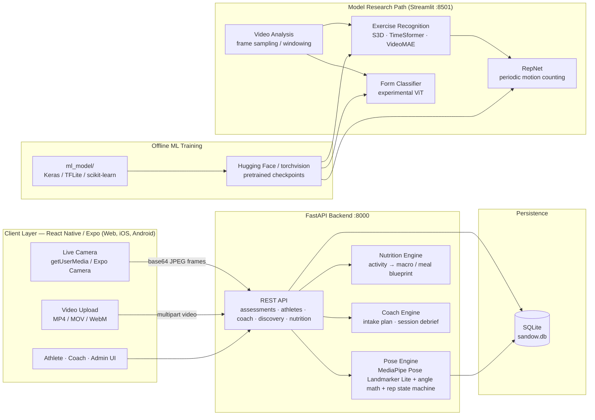
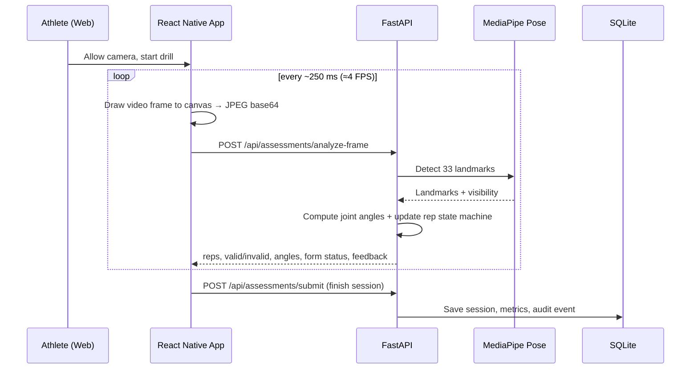

# SANDOW / AthleteAI — Sports Fitness Assessment Platform

> **Camera-only biomechanics, exercise recognition, repetition analysis, and athlete/coach workflows.**
> React Native (Expo) client · FastAPI backend · MediaPipe Pose · PyTorch video models · SQLite

[](#tech-stack)
[](#tech-stack)
[](#tech-stack)
[](#tech-stack)
[](#project-status--honest-limitations)

---

## Table of Contents

1. [Introduction](#1-introduction)
2. [Problem Statement](#2-problem-statement)
3. [Proposed Solution](#3-proposed-solution)
4. [Architecture](#4-architecture)
5. [Tech Stack](#5-tech-stack)
6. [AI, LLMs & Pretrained Models](#6-ai-llms--pretrained-models)
7. [Features](#7-features)
8. [Repository Structure](#8-repository-structure)
9. [Getting Started](#9-getting-started)
10. [API Reference](#10-api-reference)
11. [Datasets, Training & Model Provenance](#11-datasets-training--model-provenance)
12. [Testing & Validation](#12-testing--validation)
13. [Project Status & Honest Limitations](#13-project-status--honest-limitations)
14. [Roadmap](#14-roadmap)
15. [Contributing](#15-contributing)
16. [Acknowledgements](#16-acknowledgements)
17. [License](#17-license)

---

## 1. Introduction

**SANDOW / AthleteAI** turns any ordinary phone or laptop camera into a low-cost movement-assessment
workstation. It targets grassroots athletes, school/college teams, academies, and coaches who do not
have access to professional motion-capture labs.

The repository contains three connected parts:

| Part | Location | Purpose |
| :--- | :--- | :--- |
| **Cross-platform app** | `App.tsx`, `src/`, `app.json` | Athlete, coach, and admin experience on Web, iOS, and Android via Expo |
| **FastAPI backend** | `face_work/server.py`, `storage.py`, `pose_engine.py` | Real-time frame analysis, video analysis, athlete/coach data, nutrition, audit |
| **ML research & training** | `face_work/app.py`, `ml_model/` | Pretrained video models, RepNet counting, form classifiers, training pipelines |

The project was built for a sports-fitness problem statement where the goal is **objective,
repeatable movement feedback without wearables or expensive hardware**.

---

## 2. Problem Statement

Grassroots and amateur sport suffers from an **assessment gap**:

- **Coaches cannot watch every rep.** A coach supervising 20–50 athletes cannot measure joint angles,
  spinal alignment, or knee tracking in real time.
- **Motion capture is unaffordable.** Optical systems cost thousands of dollars and require a lab,
  markers, and trained operators.
- **Wearables measure the wrong thing.** Heart rate and step count do not describe squat depth,
  elbow flexion, or hip sagging.
- **Feedback is subjective and delayed.** Athletes often learn about a movement fault only after an
  injury or a recorded review session.
- **Assessment is disconnected from recovery.** Training data and nutrition/recovery guidance usually
  live in different apps.

**Problem statement in one line:** *Build a camera-based system that can recognise an exercise,
measure movement quality, count repetitions, and give athletes and coaches actionable, privacy-conscious
feedback using only a phone/laptop camera.*

---

## 3. Proposed Solution

SANDOW combines **pose estimation + exercise intelligence + role-based workflows**:

1. **Capture** — live webcam/browser camera or an uploaded `.mp4` / `.mov` / `.webm` clip.
2. **Estimate pose** — MediaPipe Pose Landmarker extracts body landmarks from each frame.
3. **Measure** — vector dot products compute joint angles (elbow, knee, hip, torso, shoulder).
4. **Count & validate** — a temporal state machine counts repetitions and applies exercise-specific
   range-of-motion / alignment thresholds.
5. **Recognise & classify (research path)** — pretrained video classifiers identify the exercise;
   RepNet estimates periodic motion; an experimental ViT classifies push-up form.
6. **Explain** — the result screen reports reps, angles, form status, confidence, and feedback.
7. **Persist & share** — sessions, athlete history, coach notes, consent, and audit events are stored
   locally in SQLite and exposed through a REST API.
8. **Fuel recovery** — an activity-mapped nutrition engine returns macro/micronutrient and meal
   recommendations for the completed workout.

The design is **edge-first / local-first**: frames are processed by a local backend, raw video is not
stored by default, and the database stays on the machine running the service.

---

## 4. Architecture

### 4.1 High-level system



### 4.2 Request flow — live camera



### 4.3 Request flow — uploaded video

1. `POST /api/assessments/analyze-video` receives the file.
2. OpenCV decodes frames; frames are sampled and passed to the pose engine.
3. Angles, rep transitions, and form status are computed per sampled frame.
4. A timeline, rep summary, accuracy score, and session record are returned.
5. The result is persisted to SQLite against the athlete ID.

### 4.4 Design principles

- **Separate UI, services, inference, and persistence** — the app never imports model code directly.
- **Local-first** — SQLite plus local inference; no mandatory cloud account.
- **Honest readiness** — if a model or weight is absent, the UI must show *unavailable*, never fake a score.
- **No rule fallback for learned tasks** — form classification is only reported when a learned model exists.
- **Bounded inference** — live analysis runs at a sampled rate; video preview is not blocked by model inference.

---

## 5. Tech Stack

### Frontend

| Technology | Version / Role |
| :--- | :--- |
| React Native | `0.81.5` |
| Expo SDK | `~54.0` |
| React | `19.1.0` |
| TypeScript | `^5.3` |
| React Navigation | `7.x` (native stack + bottom tabs) |
| react-native-svg | Skeleton / pose overlay rendering |
| react-native-web | Browser build (`localhost:8081`) |
| Expo Linear Gradient | UI theme and cards |

### Backend & data

| Technology | Role |
| :--- | :--- |
| Python | `3.12` |
| FastAPI + Uvicorn | REST API (`http://127.0.0.1:8000`) |
| Pydantic v2 | Request/response validation |
| SQLite (`sandow.db`) | Athlete profiles, sessions, notes, consent, audit |
| OpenCV | Video decode and frame handling |
| NumPy | Vector / angle mathematics |
| MediaPipe Tasks | Pose Landmarker (BlazePose-based, 33 landmarks) |

### Machine learning

| Technology | Role |
| :--- | :--- |
| PyTorch + torchvision | S3D inference, tensor operations |
| Hugging Face Transformers | TimeSformer, VideoMAE, ViT |
| Hugging Face Hub | Checkpoint download/caching |
| TensorFlow / Keras | Custom exercise-recognition MLP |
| TensorFlow Lite | On-device inference for trained heads |
| scikit-learn + joblib | Feature scaling, label encoding, metrics |
| timm | Vision Transformer loading for RepNet |
| Streamlit + streamlit-webrtc | Model research & validation UI |

### Tooling

- Git / GitHub, npm, PowerShell scripts, `pytest`-style validation scripts (plain Python asserts),
- Mermaid diagrams in documentation.

---

## 6. AI, LLMs & Pretrained Models

### 6.1 Is an LLM used?

**No LLM or external generative-AI API is used at inference time in the current codebase.**

- The "AI Coach" intake/debrief endpoints are **deterministic template/rule engines** that build plans
  and feedback from the athlete's exercise, reps, score, and duration.
- The nutrition engine is a **curated activity → macro/meal database**, not a generative model.
- `nutrition_engine.py` is explicitly structured so an LLM provider (Gemini / Claude / OpenAI) can be
  added later, but **no API keys or provider calls are included**.

This is intentional for a hackathon/edge prototype: predictable output, no per-request cost, and no
sending athlete video or health data to a third party.

### 6.2 Pretrained models used

| Model | Source | Where used | Task | Notes |
| :--- | :--- | :--- | :--- | :--- |
| **MediaPipe Pose Landmarker Lite** | Google MediaPipe | `face_work/pose_engine.py`, `ml_model/posture_assessment` | 33 body landmarks | Auto-downloaded to `face_work/models/pose_landmarker_lite.task` |
| **S3D (Kinetics-400)** | `torchvision` `S3D_Weights.KINETICS400_V1` | `face_work/recognition.py` | Exercise recognition | Lighter default in the research UI |
| **TimeSformer (Kinetics-600)** | [`facebook/timesformer-base-finetuned-k600`](https://huggingface.co/facebook/timesformer-base-finetuned-k600) | `face_work/recognition.py` | Exercise recognition | Supports jumping jacks in K600 label space |
| **VideoMAE (Kinetics-400)** | [`MCG-NJU/videomae-base-finetuned-kinetics`](https://huggingface.co/MCG-NJU/videomae-base-finetuned-kinetics) | `face_work/recognition.py` | Exercise recognition | Used alone or in "Both (agreement)" mode |
| **RepNet** | [`materight/repnet`](https://huggingface.co/materight/repnet), implementation [`materight/RepNet-pytorch`](https://github.com/materight/RepNet-pytorch) | `face_work/model_counter.py`, `vendor/repnet-pytorch` | Periodic-motion / repetition estimation | Estimates cycles, not valid-rep form |
| **ViT push-up form classifier** | [`sakkysakky/vit-pushup-form-classifier`](https://huggingface.co/sakkysakky/vit-pushup-form-classifier) @ `b4eb658` | `face_work/form_assessment.py` | Correct / incorrect / uncertain push-up form | Experimental; image-level, not rep-level |
| **ViT base processor** | [`google/vit-base-patch16-224`](https://huggingface.co/google/vit-base-patch16-224) | `form_assessment.py` | Preprocessing for the form classifier | Publisher omitted a processor file |

### 6.3 Models trained inside this repository

| Model | Location | Input → Output | Training |
| :--- | :--- | :--- | :--- |
| **Exercise Recognition MLP** | `ml_model/exercise_recognition` | 34 pose-derived features → push-up / squat / sit-up / jumping-jack | MediaPipe features → CSV → Keras Dense network (128-64-32-16) → TFLite |
| **Push-up Posture MLP** | `ml_model/posture_assessment/pushup_assessment` | 17 engineered pose features → posture class | TensorFlow Lite MLP |
| **Local form heads (candidates)** | `face_work/form_heads/`, `train_form_head.py` | Frozen ViT embeddings → correct/incorrect | Linear head; **disabled** pending independent validation |

Trained artifacts (`.keras`, `.tflite`, `.pkl`, `.safetensors`) are small and included where appropriate.
Large video-model weights are downloaded on first run and are **not** committed.

### 6.4 Model choices and honest evaluation

- Video classifiers are **general Kinetics models**, not exercise-specific form judges.
- RepNet estimates **periodic motion**, including fractional cycles. It does **not** decide whether a rep
  is valid or well-formed.
- The push-up ViT is an **experimental image classifier**. The publisher does not document preprocessing;
  the base ViT processor is an explicit assumption.
- No verified form checkpoint exists for squats, sit-ups, jumping jacks, lunges, or curls in this repo.
  Those are reported as **unavailable** rather than replaced by angle rules.
- Two test clips are **not** an accuracy benchmark. See [face_work/EVALUATION.md](face_work/EVALUATION.md)
  and [face_work/POSTURE_ASSESSMENT.md](face_work/POSTURE_ASSESSMENT.md) for the real measurements.

**Do not quote a global accuracy percentage from this prototype.** The pitch-deck figures (e.g. 98.2%)
are product targets/illustrative numbers, not results produced by the committed evaluation scripts.

---

## 7. Features

### Athlete
- Email/password-style onboarding screens, role selection, splash/welcome flow.
- **Assessment Center** with six drills: push-ups, squats, sit-ups, jumping jacks, lunges, biceps curls.
- **Live camera assessment** with skeleton overlay, joint-angle HUD, rep counter, form status, and feedback.
- **Video upload assessment** with timeline and detailed result screen.
- **Assessment history**, performance analytics, reports, achievements, and profile.
- **AI Sports Nutrition** screen: activity + goal → macros, hydration, micronutrients, meal blueprint.

### Coach
- Coach dashboard and assigned-athlete roster.
- Athlete discovery/search, shortlist, side-by-side comparison.
- Athlete details, session history, coach notes, and consent-aware sharing.

### Admin
- Admin dashboard, user management, reports, and settings.

### Backend
- Real-time frame analysis and full-video analysis.
- Exercise registry and model registry.
- Athlete profiles, history, consent updates.
- Coach roster, notes, intake plans, session debriefs.
- Talent discovery filters and audit trail.
- Nutrition recommendations.
- Health check with active-model metadata.

### Research / validation UI (`face_work/app.py`)
- Upload or live WebRTC analysis.
- Selectable S3D / TimeSformer / VideoMAE / agreement mode.
- RepNet repetition estimates with latency and coverage reporting.
- Experimental push-up form classification toggle.

> Several app screens still use bundled demo/seed data when the backend is offline. The live assessment
> path calls the backend; the coach/discovery demo screens fall back to `src/data/*.json`.

---

## 8. Repository Structure

```text
.
├── App.tsx                     # Expo entry component
├── app.json                    # Expo configuration
├── package.json                # Frontend dependencies and scripts
├── src/
│   ├── components/             # Cards, charts, navigation, shared UI
│   ├── context/                # App + auth state
│   ├── data/                   # Demo/seed JSON used when API is offline
│   ├── navigation/             # Root stack + athlete tabs
│   ├── screens/                # Auth, athlete, coach, admin, shared screens
│   ├── services/apiService.ts  # REST client for the FastAPI backend
│   ├── theme/                  # Colors, spacing, typography, shadows
│   └── types/                  # Shared TypeScript contracts
├── face_work/
│   ├── server.py               # FastAPI application
│   ├── storage.py              # SQLite schema and domain queries
│   ├── pose_engine.py          # MediaPipe pose, angles, rep state machine, form rules
│   ├── nutrition_engine.py     # Activity → nutrition blueprint
│   ├── app.py                  # Streamlit model-research UI
│   ├── recognition.py          # S3D / TimeSformer / VideoMAE inference
│   ├── model_counter.py        # RepNet inference
│   ├── form_assessment.py      # Experimental ViT push-up form classifier
│   ├── form_registry.py        # Exercise → form-model registry
│   ├── video_analysis.py       # Upload pipeline / frame sampling
│   ├── live_pipeline.py        # Live inference queue
│   ├── camera.py, pose_preview.py, runtime.py
│   ├── train_form_head.py      # Train a local linear form head
│   ├── prepare_coach_data.py   # Download prepared coach-feedback clips
│   ├── validate_*.py           # Validation scripts
│   ├── test_*.py               # Smoke/integration tests
│   ├── references/             # Validation JSON + reference images
│   ├── vendor/repnet-pytorch/  # Vendored RepNet implementation
│   ├── EVALUATION.md           # Actual model evaluation and failures
│   ├── POSTURE_ASSESSMENT.md   # Form-classifier status and limits
│   ├── ONLINE_FORM_DATA.md     # External form-data notes
│   ├── architecture.md         # Detailed architecture guidance
│   └── features.md             # Feature/role requirements
├── ml_model/
│   ├── exercise_recognition/   # Feature extraction, training, TFLite model, dataset
│   └── posture_assessment/     # Push-up posture MLP and demo
├── assets/                     # Expo icons and splash assets
└── README.md
```

> Large files: datasets and sample videos under `ml_model/` are committed for the hackathon demo.
> Generated model caches, `.venv`, `models/`, `sample_videos/`, `screenshots/`, logs, and
> `sandow.db` are ignored by Git.

---

## 9. Getting Started

### Prerequisites

- **Node.js 20+** and npm
- **Python 3.12**
- A webcam/browser for live mode (Chrome or Edge recommended)
- Optional: CUDA-capable GPU for faster PyTorch inference (CPU works, but slower)

### 9.1 Run the FastAPI backend (required for live/upload assessment)

```powershell
cd face_work
python -m venv .venv
.venv\Scripts\python.exe -m pip install -r requirements.txt
.venv\Scripts\python.exe -m uvicorn server:app --host 127.0.0.1 --port 8000 --reload
```

Or use the helper script:

```powershell
cd face_work
.\start-backend.ps1
```

- API docs: <http://127.0.0.1:8000/docs>
- Health check: <http://127.0.0.1:8000/api/health>

On first live request the pose model is downloaded automatically to
`face_work/models/pose_landmarker_lite.task`. `sandow.db` is created automatically.

### 9.2 Run the Expo app

```powershell
npm install
npm run web
```

Open <http://localhost:8081>. For a phone, use `npm start` and scan the Expo QR code.

> The API URL is currently `http://127.0.0.1:8000/api` in `src/services/apiService.ts`. For a physical
> phone, replace `127.0.0.1` with your computer's LAN IP and keep both devices on the same network.

### 9.3 Run the Streamlit model-research UI (optional)

```powershell
cd face_work
.venv\Scripts\python.exe -m streamlit run app.py
```

Open the URL printed in the terminal (default <http://localhost:8501>). The first run downloads large
video-model weights; expect a slow start and significant disk usage.

### 9.4 Verify the system

```powershell
cd face_work
.venv\Scripts\python.exe smoke_test.py
.venv\Scripts\python.exe validate_inputs.py
.venv\Scripts\python.exe validate_models.py
.venv\Scripts\python.exe validate_fast_model.py
```

Some validation scripts expect sample videos or a server on port `8502`; see
[face_work/README.md](face_work/README.md) for the exact prerequisites.

---

## 10. API Reference

Base URL: `http://127.0.0.1:8000/api`

| Method | Endpoint | Purpose |
| :--- | :--- | :--- |
| `GET` | `/health` | Service status, database, active model registry |
| `GET` | `/models` | Model registry with provenance/status |
| `GET` | `/exercises` | Supported drills and target metrics |
| `POST` | `/assessments/analyze-frame` | Analyse one base64 camera frame |
| `POST` | `/assessments/analyze-video` | Analyse an uploaded video (multipart) |
| `POST` | `/assessments/submit` | Persist a completed assessment |
| `GET` | `/assessments/history/{athlete_id}` | Athlete session history |
| `GET` | `/athletes/{athlete_id}` | Profile, goals, notes, recent sessions |
| `PUT` | `/athletes/{athlete_id}/consent` | Update coach/government sharing consent |
| `GET` | `/coach/{coach_id}/roster` | Assigned athletes and latest metrics |
| `POST` | `/coach/notes` | Add a coach note to an athlete/session |
| `GET` | `/coach/notes/{athlete_id}` | Read coach notes |
| `GET` | `/discovery/athletes` | Filter athletes by sport/state/district/rating |
| `GET` | `/nutrition/recommendations` | Nutrition blueprint for exercise + goal |
| `POST` | `/coach/intake-plan` | Generate a training plan from intake data |
| `POST` | `/coach/debrief` | Session debrief from reps, score, duration |
| `GET` | `/audit` | Recent audit events |

Example — analyse a frame:

```json
POST /api/assessments/analyze-frame
{
  "image": "data:image/jpeg;base64,...",
  "exercise": "Push-ups",
  "session_id": "session_123",
  "reset": false
}
```

```json
{
  "detected": true,
  "landmarks": [{ "id": 11, "name": "left_shoulder", "x": 0.42, "y": 0.31, "visibility": 0.98 }],
  "primary_angle": 88.4,
  "secondary_angle": 171.2,
  "rep_count": 12,
  "valid_reps": 11,
  "invalid_reps": 1,
  "stage": "DOWN",
  "form_status": "Correct",
  "feedback": "Full range of motion...",
  "accuracy_score": 91.7
}
```

---

## 11. Datasets, Training & Model Provenance

### Custom exercise-recognition model

```powershell
cd ml_model/exercise_recognition
python training/extract_dataset.py     # videos → MediaPipe features → extracted_csv/features.csv
python training/train_model.py         # Keras MLP → models/*.keras + scaler/encoder
python training/convert_to_tflite.py   # TFLite export
```

- **Classes:** push-up, squat, sit-up, jumping jack.
- **Features:** 34 angle/distance/normalised-coordinate features from MediaPipe landmarks.
- **Split:** 80/20 stratified, class-balanced resampling, standard scaling.
- **Outputs:** `exercise_model.keras`, `final_model.keras`, `exercise_model.tflite`,
  `scaler.pkl`, `label_encoder.pkl`, training curves.

### Push-up posture head

`ml_model/posture_assessment/pushup_assessment` contains a TFLite MLP trained on 17 engineered pose
features. It is a **separate posture experiment**, not the same model as the ViT form classifier in
`face_work/form_assessment.py`.

### External data notes

- Push-up form smoke test: [Kaggle pushup dataset](https://www.kaggle.com/datasets/mohamadashrafsalama/pushup)
  (CC BY-NC-SA 4.0, used locally, not redistributed).
- Coach-feedback clips: [Qualcomm Exercise Video Dataset (QEVD)](https://www.qualcomm.com/developer/software/qevd-dataset)
  via the Voxel51 mirror; used as weak labels, not redistributed.
- Test clips: one public Pexels push-up video; a local squat clip with no preserved source URL.
- Full details and caveats: `face_work/ONLINE_FORM_DATA.md`, `face_work/POSTURE_ASSESSMENT.md`.

### Dataset governance

- Keep train/validation/test separate; prefer participant/video-disjoint splits.
- Record source, license, preprocessing, sample count, and label origin.
- Do not turn file-name heuristics (`"correct" in filename`) into ground truth.
- Do not claim a model is validated because it ran successfully once.

---

## 12. Testing & Validation

### Automated checks

| Script | What it covers |
| :--- | :--- |
| `smoke_test.py` | Import and basic pipeline checks |
| `test_app.py` | Streamlit app render / component checks |
| `test_live_pipeline.py` | Live queue and scheduling |
| `test_recognition.py` | Recognition label mapping |
| `test_form_assessment.py` | Form-classifier routing and abstention |
| `test_form_training.py` | Form-head training safeguards |
| `test_system.py` | Backend/domain integration |
| `validate_inputs.py` | Corrupt / too-short video rejection |
| `validate_models.py` | Real checkpoints on local clips |
| `validate_fast_model.py` | Warm S3D window timing |
| `validate_server.py` | Real Streamlit websocket/session render |
| `validate_posture*.py` | Form-classifier and integration checks |

### Measured results (not marketing claims)

From `face_work/EVALUATION.md` (CPU-only laptop):

| Clip | Manual cycles | TimeSformer | VideoMAE | RepNet estimate | Upload time |
| :--- | ---: | :--- | :--- | ---: | ---: |
| Push-ups, 11.64 s | 3 | Push-ups | Push-ups | 2.7446 | 43.76 s |
| Squats, 20.487 s | 2 | Squats | Squats | 1.0186 | 55.90 s |

- S3D is the lighter default; its warm live window took ~7.3 s for 8.0 s of footage.
- TimeSformer's warm live window took ~13.2 s for the same footage.
- Full upload inference is **slower than real time** on the test CPU.
- Two clips cannot establish accuracy. Manual labels were provisional, not double-annotated.

### Test suite status

The repository has validation evidence for model loading, upload pipelines, live scheduling, screen
rendering, and API behavior. It does **not** have a verified physical-webcam accuracy benchmark or
held-out multi-subject form evaluation. See the linked documents before making performance claims.

---

## 13. Project Status & Honest Limitations

**Status: hackathon prototype / research preview — not a medical device, coaching certification, or
talent-selection authority.**

Known limitations:

- **Live latency:** large models on CPU are not instantaneous. The app samples frames (~4 FPS) and
  reports results asynchronously.
- **Rep counting:** RepNet estimates periodic motion; counts can drift at window boundaries and are not
  valid-rep determinations.
- **Form coverage:** only an experimental push-up form classifier is integrated. Other exercises show
  *unavailable* rather than invented feedback.
- **Recognition coverage:** video classifiers are Kinetics models; arbitrary exercises/curls are not
  guaranteed. Upload one exercise per clip.
- **Camera validation:** physical browser-camera lifecycle and stable long-session throughput were not
  fully validated in automation.
- **Demo data:** coach/discovery/admin screens fall back to bundled JSON when the backend is unavailable.
- **Authentication:** the app demonstrates roles and local persistence; it is not production-grade auth
  (no HTTPS, session hardening, or multi-tenant isolation).
- **Nutrition/coach engines:** deterministic recommendations, not medical or dietitian advice.
- **Privacy:** local SQLite is suitable for a demo; production needs encryption, retention policy,
  consent enforcement at query time, backups, and audit review.

**Never present model inference as a diagnosis. Always keep a human (coach/clinician) in the loop.**

---

## 14. Roadmap

- [ ] Participant-disjoint form datasets and validated models for all six exercises.
- [ ] WebRTC / native camera streaming with stable 30 FPS and lower-latency inference.
- [ ] Server-side multi-person tracking and automatic exercise segmentation.
- [ ] Strong authentication, encrypted storage, and consent enforcement in every query/export.
- [ ] PDF/CSV scouting reports and combine-ready exports.
- [ ] On-device CoreML / TFLite inference for offline mobile use.
- [ ] Optional LLM coaching layer with explicit consent, provider configuration, and audit logging.
- [ ] CI for Python tests, TypeScript type-check, and reproducible model validation.

---

## 15. Contributing

See [CONTRIBUTING.md](CONTRIBUTING.md).

Quick rules:

1. Do not add fake metrics, canned coaching, or angle-rule fallbacks for learned form tasks.
2. Keep model weights/datasets out of Git unless intentionally small and licensed.
3. Add or update a validation script for every model claim.
4. Keep the README and `face_work/*.md` status documents honest when coverage changes.

---

## 16. Acknowledgements

- **Google MediaPipe** — pose landmarker.
- **Facebook Research / Hugging Face** — TimeSformer.
- **MCG-NJU / Hugging Face** — VideoMAE.
- **PyTorch / torchvision** — S3D.
- **materight** — RepNet weights and PyTorch implementation.
- **sakkysakky** — experimental push-up form classifier.
- **Qualcomm / Voxel51** — exercise video dataset used for weak-label experiments.
- Open-source React Native, Expo, FastAPI, and Streamlit communities.

Model licenses belong to their original authors. Review each upstream license before commercial
distribution — especially the non-commercial datasets and third-party checkpoints.

---

## 17. License

Source code in this repository is released under the **MIT License**; see [LICENSE](LICENSE).
Third-party models, datasets, and vendored code remain under their own licenses and are **not**
relicensed by this project.
